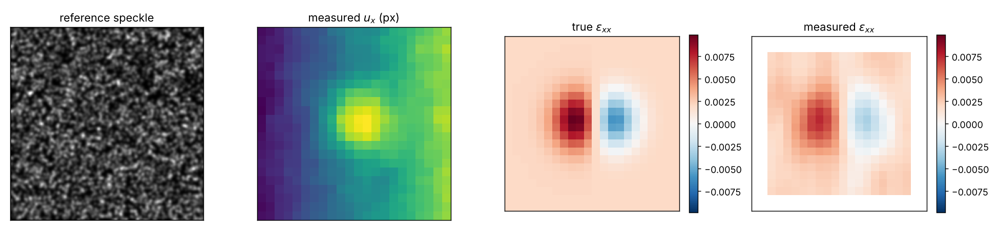
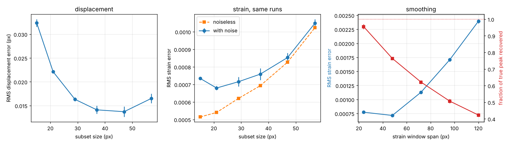

# Strain from image correlation

## What this is about

Image correlation is a way of measuring how something deforms without touching
it. You take a picture of a speckled surface before loading and another one
after, you match small patches between the two pictures, and the offsets tell
you how far each patch moved. That gives you a displacement field.

Most of the time displacement is not what you actually want. You want strain,
which is the derivative of displacement, so you have to differentiate the
measurement. Differentiating measured data is where the trouble starts, because
differentiation amplifies whatever error is sitting in the displacements, and
the usual fix is to smooth before differentiating. Smoothing a field in order to
differentiate it also flattens whatever peaks are in it, and peaks are often the
whole reason for doing the measurement.

So there are two knobs. The patch size used for correlation, and the size of the
window used to smooth before differentiating. I wanted to know whether tuning
them for a good displacement field also gives you a good strain field, because I
had assumed it did and I was not sure why I assumed that.

## Where the data comes from

There is no external data. Everything here is generated by the code in this
repo with fixed random seeds, so running `python -m src.experiment` reproduces
every number below.

I generate a 301 by 301 pixel speckle pattern by dropping 5500 Gaussian blobs at
random positions. That is the stand-in for a sprayed speckle pattern. Then I
apply a displacement field I chose myself and resample the image to get the
deformed frame. The field is a uniform 0.002 stretch in x with a Poisson
contraction in y, plus a localised bulge in the middle that creates a strain
concentration. On the measurement grid the true strain runs from -0.00585 to
0.00987, so the concentration is about five times the background. Displacements
are between one and two pixels.

The reason for doing it this way instead of using a real experiment is that I
need to know the right answer. If I ran this on real images I could compare two
methods against each other but I could not say which one was closer to the
truth, and that is the only question I care about here. I add Gaussian noise
with a standard deviation of 0.01 on an intensity range of about 0.84, and I
repeat every noisy measurement three times with different noise draws.

The warp is done carefully. The displacement is defined at the reference
position, so filling a pixel of the deformed image means solving for which
reference point landed there rather than assuming it is the obvious thing. I do
that with a few fixed point passes. At these strains the shortcut would have
been wrong by about 0.02 pixels, which is the same size as the errors I am
trying to measure, so it would have mattered.

## The question

Does the patch size that gives the most accurate displacement field also give
the most accurate strain field, and does the smoothing I need to make strain
usable cost me anything I should know about?

## How it works

The correlation is subset based. For each point on a grid I take a square patch
of the reference image, find the best integer pixel match in the deformed image
by normalised cross correlation, and then refine it to sub-pixel by Gauss-Newton
on a zero-normalised sum of squared differences. I take the image gradient from
the reference side rather than the deformed side, which means the Hessian is
built once per patch instead of once per iteration. My first version used a
general purpose optimiser and took twenty seconds a run. This one takes about a
second and a half and is more accurate, which surprised me until I realised the
general optimiser was stopping on its own tolerance rather than on convergence.

Each patch is allowed to slide but not to stretch or rotate. That is the
simplest thing you can do and it is deliberate, because a patch that cannot
stretch is going to struggle across a strain gradient, and I wanted that effect
present rather than designed away.

For strain I fit a plane to the displacements over a window of grid points and
take the gradient of the fitted plane. The window size is the smoothing knob.

I check the correlation against cases where I know the answer exactly. Two
identical images have to give zero. A whole pixel shift has to come back as that
whole pixel shift. A 0.37 pixel shift with no noise has to come back to within a
hundredth of a pixel. The plane fit has to return exact slopes when it is handed
an exactly linear field. There are 24 tests and they run in under three seconds.

## What happened





Patch size against displacement error, averaged over three noise draws:

| patch (px) | displacement RMS error (px) | strain RMS error | strain RMS, no noise |
|---|---|---|---|
| 15 | 0.0324 | 0.000734 | 0.000515 |
| 21 | 0.0221 | 0.000680 | 0.000541 |
| 29 | 0.0163 | 0.000716 | 0.000620 |
| 37 | 0.0141 | 0.000759 | 0.000693 |
| 47 | 0.0137 | 0.000853 | 0.000827 |
| 57 | 0.0165 | 0.001048 | 0.001023 |

Displacement error falls by a factor of 2.4 as the patch grows from 15 to 47
pixels and then turns back up. Strain error, measured on the same runs, bottoms
out at 21 pixels. At 47 pixels, where the displacement field is at its best, the
strain field is already 25 per cent worse than its own best, and at 57 pixels it
is 54 per cent worse. The two measurements want different patch sizes and the
gap is not small.

The fourth column is the part I did not expect to be so clear. With the noise
switched off entirely, strain error still doubles across the same range of patch
sizes. So the penalty for a large patch is not noise. It is bias, from a patch
that slides but cannot stretch being asked to sit on top of a strain gradient.
Averaging over more pixels does not help with that, it causes it.

Now the smoothing window, with the patch held at 29 pixels:

| window span (px) | strain RMS error | fraction of true peak recovered |
|---|---|---|
| 24 | 0.000773 | 0.955 |
| 48 | 0.000716 | 0.764 |
| 72 | 0.001130 | 0.621 |
| 96 | 0.001708 | 0.507 |
| 120 | 0.002394 | 0.423 |

RMS error has a shallow minimum at a 48 pixel window. Peak recovery does not
have a minimum, it just falls, and it falls fast. At the window that RMS error
likes best, the height of the strain concentration is already down to 76 per
cent of its true value. The window that keeps 95 per cent of the peak is the
smallest one I tried, and RMS error says that window is worse.

The spread across the three noise draws is tiny next to all of this. The largest
standard deviation on any peak recovery number is 0.014, against differences
between windows of 0.1 and more.

## Limitations

The speckle is synthetic and well behaved. Real patterns have uneven density,
blown out highlights and areas with no texture at all, and all of those make
correlation worse in ways this does not capture.

The patch is translation only. Real implementations use first order or second
order shape functions that let the patch stretch, and those would reduce the
bias I measured, though they would not remove it, since the patch still cannot
follow a gradient that curves inside it. I would want to repeat this with a
first order shape function before claiming the size of the effect transfers.

This is two dimensional. Volume correlation on three dimensional scans has the
same structure but the patches are cubes, so the number of pixels in a patch
grows as the cube of its width rather than the square, and I would not assume
the trade-off sits in the same place.

The noise is Gaussian and independent at every pixel. Detector noise is usually
not, and the smoothing step is exactly the kind of thing that behaves
differently when the noise is correlated between neighbouring pixels.

I only tested one displacement field with one concentration width. The best
window is obviously going to depend on how sharp the feature is relative to the
grid spacing, and I have one data point on that.

## What I take from it

The thing I came in assuming was wrong. Tuning for a good displacement field
does not give you a good strain field, and in this setup the patch size that
minimises displacement error leaves strain error 25 per cent above its own
minimum.

The second thing is that a large patch hurts strain even with no noise at all,
which means it is not something more averaging or a cleaner camera will fix.

The third is the one I would be most careful about in practice. If you pick a
smoothing window by looking at RMS error over the whole field, which is the
natural thing to do, you will pick a window that has already lost about a
quarter of the height of the concentration, and the RMS number will not warn you
because most of the field is background and the background is fine. A global
error measure is dominated by the part of the field you were not interested in.
If the peak is the thing you are measuring, the peak has to be what you tune on.

## Running it

```
pip install -r requirements.txt
python -m src.experiment     # about a minute, writes results.json and figures/
python -m pytest tests/ -q   # 24 tests, about three seconds
```
